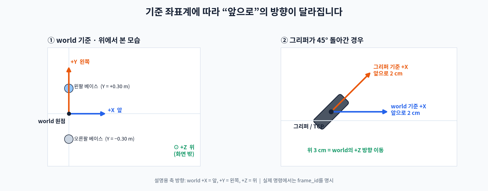
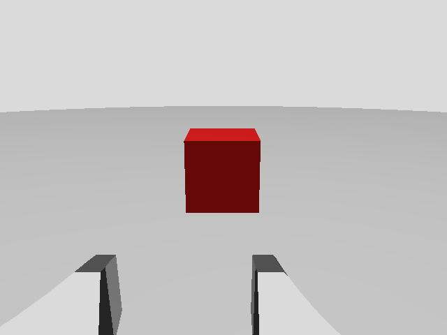

# Piper 그리퍼 TCP를 물체 표면 3 cm 앞까지 이동하기

이 예제는 왼쪽 그리퍼의 TCP(Tool Center Point)를 물체의 `−X` 면에서 3 cm 떨어진 위치로 이동한다. 물체의 중심 자세와 X축 크기를 입력받아 TCP의 목표 자세를 계산하고, 이를 `left_arm_link6`의 목표 자세로 변환해 MoveIt에 전달한다. `setPoseTarget()`으로 계획하므로 도착 자세는 지정되지만 이동 경로가 직선이라는 보장은 없다.



## 좌표계와 목표 위치

물체 중심의 `PoseStamped`는 `world` 좌표계로 표현한다. 물체의 로컬 `−X` 면으로 접근하며, TCP의 로컬 `+X` 축이 물체 쪽을 향하도록 정한다. 다른 면에서 접근하거나 그리퍼를 돌려야 하면 아래 코드의 `object_tcp` 위치 또는 회전을 바꾼다.

물체의 X축 크기가 10 cm라면 `−X` 면은 중심에서 5 cm 떨어져 있다. 면에서 3 cm 앞에 TCP를 두려면 중심에서 `−X`로 8 cm 떨어진 위치를 목표로 한다.

```text
물체 중심 ── 5 cm ── 물체의 −X 면 ── 3 cm ── TCP 접근 목표

T_world_tcp_goal = T_world_object × T_object_tcp_goal
T_world_arm_goal = T_world_tcp_goal × inverse(T_arm_tcp)
```

여기서 `T_arm_tcp`는 `left_arm_link6`에서 `left_tcp`까지의 고정 변환이다. 곱셈 순서는 TCP 목표를 팔 끝 링크의 목표로 바꾼다.

## TCP 링크와 실행 조건

현재 [Piper URDF](../src/piper_arm_description/urdf/piper_description.urdf.xacro)에는 `left_tcp`가 없다. 그리퍼의 실제 집기 중심을 측정한 뒤 `left_gripper_base` 아래에 고정 링크와 조인트를 추가한다. 아래 `0.16`은 구조를 설명하기 위한 값이며, 측정값으로 교체해야 한다.

```xml
<link name="left_tcp"/>
<joint name="left_tcp_joint" type="fixed">
  <parent link="left_gripper_base"/>
  <child link="left_tcp"/>
  <origin xyz="0 0 0.16" rpy="0 0 0"/>
</joint>
```

`robot_state_publisher`가 `left_arm_link6 → left_tcp` TF를 발행해야 한다. 물체의 크기와 자세는 인식 결과나 사용자가 지정한 값에서 받아야 한다. 물체와 충돌하지 않는 경로를 계획하려면 물체 형상도 MoveIt 계획 장면에 등록한다. 앞서 수정한 [SRDF](../src/piper_arm_moveit_config/config/piper_dual_gripper.srdf)의 왼쪽 카메라 충돌 설정은 `move_group`을 재시작해야 적용된다.

## Gazebo 영상에서 물체 Pose 받기

[Gazebo 영상 수집부터 YOLOv8 학습·검증·ONNX 적용까지의 단계별 가이드](yolov8_gazebo_training_guide.md)를 먼저 참고한다. 다른 물체로 바꿀 때 수정할 데이터셋, 클래스, Pose 가정도 설명한다.

[YOLOv8 물체 인식 노드](../src/piper_arm_moveit_config/src/color_object_pose_node.cpp)는 Gazebo 브리지의 `/left_camera/rgbd/image`와 `/left_camera/rgbd/points`를 시간에 맞춰 받는다. YOLOv8 ONNX 검출 모델이 선택한 물체 상자의 중앙 영역에서 유효한 XYZ 점을 모아 중앙값을 계산하고, 이를 `world`로 변환해 `/detected_object/surface_point`에 발행한다. `/detected_object/pose`는 이 표면점에서 알려진 물체 X축 길이의 절반만큼 물체 중심 쪽으로 이동한 `PoseStamped`다. `/detected_object/debug_image`에는 검출 상자와 점수를 그린 RGB 영상이 발행된다.

`model/red_target_yolov8s.onnx`는 Gazebo 왼쪽 카메라 영상으로 학습한 빨간 시험 상자 전용 YOLOv8s 모델이다. `gazebo_moveit.launch.py`에서 이 모델을 자동으로 실행한다. ONNX는 NMS를 포함하지 않는 기본 YOLOv8 검출 출력(`배치 × (4 + 클래스 수) × 후보 수`)이다. 필요한 ROS 의존 패키지는 `ros-jazzy-onnxruntime-vendor`다.

```bash
sudo apt install ros-jazzy-onnxruntime-vendor
colcon build --packages-select piper_arm_moveit_config --symlink-install
source install/setup.zsh
ros2 launch piper_arm_moveit_config gazebo_moveit.launch.py
# 다른 터미널에서 확인
source install/setup.zsh
ros2 topic echo /detected_object/pose --once
```

패키지에 복사한 `model/yolov8s.onnx`는 일반 COCO 사전 학습 모델이다. 이 모델의 추론 경로만 따로 확인하려면 아래처럼 실행할 수 있다. `target_class_id:=-1`은 클래스와 관계없이 최고 점수 검출을 선택하므로 `/detected_object/pose`를 빨간 시험 상자의 자세로 사용하면 안 된다. `/detected_object/debug_image`를 RViz의 Image 디스플레이에서 확인한다.

```bash
ros2 run piper_arm_moveit_config color_object_pose_node --ros-args \
  -p use_sim_time:=true \
  -p model_path:="$(ros2 pkg prefix piper_arm_moveit_config)/share/piper_arm_moveit_config/model/yolov8s.onnx" \
  -p target_class_id:=-1
```

위 값은 **X축 길이 10 cm, `world` 축에 정렬된 물체의 `−X` 면**을 가정한다. YOLOv8의 검출 상자는 물체의 회전이나 정확한 3D 중심을 주지 않으므로 `object_yaw_rad`와 `object_size_x_m`은 실제 물체에 맞게 지정해야 한다. 배경이 검출 상자 중앙에 섞이거나 다른 면이 더 많이 보이면 중심 추정이 어긋날 수 있다.

현재 `piper.world`에는 왼쪽 카메라 앞의 빨간색 정적 시험 상자가 있다. `world` 기준 중심은 `(0.65, 0.29, 0.10) m`, 크기는 `0.10 × 0.10 × 0.10 m`다. 140장의 상자 영상과 20장의 빈 장면을 수집하고 128장을 학습, 32장을 검증에 사용했다. YOLOv8s를 320 px, 12 epoch으로 학습한 결과 이 검증 세트에서 mAP50은 0.995였다. 현재 Gazebo 장면에서 노드가 발행한 중심 Pose는 약 `(0.6500, 0.2907, 0.1126) m`였다. 이 수치는 같은 시뮬레이션 장면에서 얻은 결과이며 다른 조명, 물체, 실제 카메라에서의 성능을 뜻하지 않는다.

데이터를 다시 수집하려면 Gazebo 실행 중 `python3 src/piper_arm_moveit_config/scripts/collect_red_box_dataset.py --output /tmp/robot_yolo_dataset --positive 140 --negative 20`을 실행한다. 스크립트는 Gazebo 상자를 여러 위치로 옮기고 RGB 영상의 빨간 영역을 학습 라벨로 저장한 뒤 원래 위치로 돌린다. 학습에는 YOLOv8s 사전 학습 가중치와 Ultralytics가 필요하다. 학습 결과의 `best.pt`를 `YOLO(best_pt).export(format='onnx', imgsz=320, batch=1, nms=False, simplify=True)`로 내보내 `model/red_target_yolov8s.onnx`에 넣는다. 수집한 데이터와 PyTorch 체크포인트는 각각 `/tmp/robot_yolo_dataset`, `/tmp/robot_yolo_train_runs/red_box/weights/best.pt`에 있다.



## MoveIt C++ 함수

다음 함수는 실행 중인 ROS 2 노드에서 생성한 `MoveGroupInterface`와 TF 버퍼를 받는다. 노드의 executor가 돌고 있어야 관절 상태와 TF를 받을 수 있다. `object_pose.header.frame_id`는 `world`이며, `object_size_x`와 `gap_m`의 단위는 미터다.

```cpp
#include <geometry_msgs/msg/pose_stamped.hpp>
#include <moveit/move_group_interface/move_group_interface.hpp>
#include <tf2/LinearMath/Transform.h>
#include <tf2/time.h>
#include <tf2_geometry_msgs/tf2_geometry_msgs.hpp>
#include <tf2_ros/buffer.hpp>

#include <stdexcept>

bool moveTcpToObjectFront(
    moveit::planning_interface::MoveGroupInterface& move_group,
    tf2_ros::Buffer& tf_buffer,
    const geometry_msgs::msg::PoseStamped& object_pose,
    double object_size_x,
    double gap_m = 0.03)
{
    if (object_pose.header.frame_id != "world") {
        throw std::invalid_argument("object_pose must be in world frame");
    }
    if (object_size_x <= 0.0 || gap_m < 0.0) {
        throw std::invalid_argument("invalid object size or gap");
    }

    // 물체 중심의 자세: world → object
    tf2::Transform world_object;
    tf2::fromMsg(object_pose.pose, world_object);

    // 물체의 -X 면에서 gap_m만큼 바깥쪽에 TCP를 둔다.
    // 단위 회전은 TCP 축을 물체 축에 맞춘다.
    tf2::Transform object_tcp;
    object_tcp.setIdentity();
    object_tcp.setOrigin(
        tf2::Vector3(-(object_size_x / 2.0 + gap_m), 0.0, 0.0));

    const tf2::Transform world_tcp_goal = world_object * object_tcp;

    // lookupTransform(target, source)는 target → source 변환을 반환한다.
    const auto tcp_tf = tf_buffer.lookupTransform(
        "left_arm_link6", "left_tcp", tf2::TimePointZero,
        tf2::durationFromSec(2.0));

    tf2::Transform arm_tcp;
    tf2::fromMsg(tcp_tf.transform, arm_tcp);
    const tf2::Transform world_arm_goal =
        world_tcp_goal * arm_tcp.inverse();

    geometry_msgs::msg::Pose target_pose;
    tf2::toMsg(world_arm_goal, target_pose);

    move_group.setPoseReferenceFrame("world");
    move_group.setEndEffectorLink("left_arm_link6");
    move_group.setStartStateToCurrentState();
    move_group.setMaxVelocityScalingFactor(0.2);

    if (!move_group.setPoseTarget(target_pose, "left_arm_link6")) {
        return false;
    }

    moveit::planning_interface::MoveGroupInterface::Plan plan;
    if (move_group.plan(plan) != moveit::core::MoveItErrorCode::SUCCESS) {
        return false;
    }

    return move_group.execute(plan) ==
           moveit::core::MoveItErrorCode::SUCCESS;
}
```

`MoveGroupInterface`는 이 저장소의 `left_arm` 그룹으로 생성한다. 헤더와 링크에 해당하는 의존성은 `moveit_ros_planning_interface`, `moveit_msgs`, `tf2`, `tf2_geometry_msgs`, `tf2_ros`, `geometry_msgs`, `rclcpp`다. 이 함수는 `plan()` 성공 후 즉시 실행하므로, 경로만 미리 확인하려면 `execute()` 호출을 분리한다.

## 물체 표면까지 직선 접근

위 함수는 표면에서 3 cm 떨어진 접근 지점까지만 이동한다. 이어서 물체를 집기 위해 남은 3 cm를 진행하려면, 접근 지점의 TCP 자세에서 물체 로컬 `+X` 방향으로 3 cm 이동한 두 번째 경유점을 만든다. 해당 구간은 `computeCartesianPath()`에서 충돌 검사를 켠 상태로 계산하고, 경로 완성 비율이 100%일 때만 실행한다. 물체가 계획 장면에 들어 있다면 실제 접촉 단계의 허용 충돌 범위도 집기 동작에 맞게 정의해야 한다.
