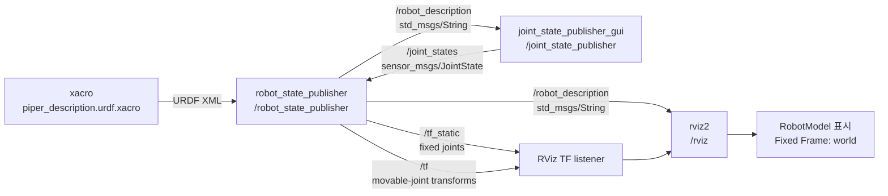

# Piper Arm Description

두 Piper arm의 URDF/Xacro, end-effector, RViz 표시 설정을 제공하는 ROS 2 패키지입니다.

## RViz에서 모델 표시

워크스페이스를 빌드하고 source한 뒤 다음을 실행합니다.

```bash
ros2 launch piper_arm_description display.launch.py
```

말단장치와 두 arm 사이 간격은 launch 인자로 선택할 수 있습니다.

```bash
ros2 launch piper_arm_description display.launch.py \
  left_end_effector:=gripper \
  right_end_effector:=pika \
  arm_spacing:=0.60
```

`left_end_effector`와 `right_end_effector`에는 `none`, `gripper`, `revo2`, `pika`를 사용할 수 있습니다.

## `display.launch.py` 노드 및 토픽 그래프



동작 순서는 다음과 같습니다.

1. `xacro`가 launch 인자(`left_end_effector`, `right_end_effector`, `arm_spacing`)를 반영해 URDF를 생성합니다.
2. `robot_state_publisher`가 URDF를 `/robot_description`으로 발행합니다.
3. `joint_state_publisher_gui`가 URDF에서 관절 목록을 만들고, GUI 슬라이더 값으로 `/joint_states`를 발행합니다.
4. `robot_state_publisher`가 `/joint_states`를 받아 `/tf`를 계산하고, 고정 조인트 TF는 `/tf_static`으로 발행합니다.
5. RViz가 URDF와 TF를 구독해 로봇 모델을 표시합니다.

| 토픽 | Publisher | 역할 |
| --- | --- | --- |
| `/robot_description` | `robot_state_publisher` | xacro로 생성된 URDF |
| `/joint_states` | `joint_state_publisher_gui` | GUI에서 변경한 관절 위치 |
| `/tf_static` | `robot_state_publisher` | `world`부터 base link 등 고정 조인트 TF |
| `/tf` | `robot_state_publisher` | arm/gripper의 움직이는 관절 TF |

## `/joint_states` 관절 이름

`joint_state_publisher_gui`는 `/joint_states` 토픽에 `sensor_msgs/msg/JointState` 메시지를 발행합니다. 기본값(양쪽 end-effector가 `none`)에서 메시지의 `name[]` 배열에는 다음 12개 관절이 포함됩니다.

```text
left_arm_joint1, left_arm_joint2, left_arm_joint3,
left_arm_joint4, left_arm_joint5, left_arm_joint6,
right_arm_joint1, right_arm_joint2, right_arm_joint3,
right_arm_joint4, right_arm_joint5, right_arm_joint6
```

선택한 end-effector에 따라 다음의 가변 관절이 해당 arm 측에 추가됩니다.

| End-effector | 추가되는 `name[]` 항목 |
| --- | --- |
| `gripper` | `left_gripper_joint1`, `left_gripper_joint2` 또는 `right_gripper_joint1`, `right_gripper_joint2` |
| `pika` | `left_left_joint`, `left_right_joint` 또는 `right_left_joint`, `right_right_joint` |
| `revo2` | thumb, index, middle, ring, pinky 관절 11개. 예: `left_thumb_metacarpal_joint`, `left_thumb_proximal_joint`, `left_index_proximal_joint` |

`left_arm_world_to_base_link`, `right_arm_world_to_base_link`, `left_gripper_base_joint`처럼 `fixed` 타입인 joint는 `/joint_states`에 포함되지 않습니다. 이들은 `robot_state_publisher`가 `/tf_static`으로 발행합니다.

## 토픽 메시지 구조 예시

아래는 기본 설정(`arm_spacing:=0.60`, 양쪽 end-effector `none`)의 핵심 토픽 세 가지를 표현한 예시입니다. `...`는 실행 중인 관절 위치와 시간에 따라 달라지는 값입니다.

### `/joint_states`

`joint_state_publisher_gui`가 발행하는 `sensor_msgs/msg/JointState` 메시지입니다. `name`, `position`, `velocity`, `effort` 배열의 같은 인덱스가 하나의 가변 관절을 나타냅니다.

```yaml
header:
  stamp: {sec: ..., nanosec: ...}
name:
  - left_arm_joint1
  - left_arm_joint2
  - left_arm_joint3
  - left_arm_joint4
  - left_arm_joint5
  - left_arm_joint6
  - right_arm_joint1
  - right_arm_joint2
  - right_arm_joint3
  - right_arm_joint4
  - right_arm_joint5
  - right_arm_joint6
position: [0.0, 0.0, 0.0, 0.0, 0.0, 0.0, 0.0, 0.0, 0.0, 0.0, 0.0, 0.0]
velocity: []
effort: []
```

### `/tf_static`

`robot_state_publisher`가 한 번 발행하고 보존하는 `tf2_msgs/msg/TFMessage`입니다. 기본 arm 간격에서 두 base link의 고정 변환은 다음과 같습니다.

```yaml
transforms:
  - header:
      frame_id: world
    child_frame_id: left_arm_base_link
    transform:
      translation: {x: 0.0, y: 0.3, z: 0.0}
      rotation: {x: 0.0, y: 0.0, z: 0.0, w: 1.0}
  - header:
      frame_id: world
    child_frame_id: right_arm_base_link
    transform:
      translation: {x: 0.0, y: -0.3, z: 0.0}
      rotation: {x: 0.0, y: 0.0, z: 0.0, w: 1.0}
```

### `/tf`

`robot_state_publisher`가 `/joint_states`의 관절 위치를 바탕으로 지속해서 발행하는 `tf2_msgs/msg/TFMessage`입니다. 메시지의 각 항목은 parent frame(`header.frame_id`)과 child frame(`child_frame_id`)의 변환입니다.

```yaml
transforms:
  - header:
      stamp: {sec: ..., nanosec: ...}
      frame_id: left_arm_base_link
    child_frame_id: left_arm_link1
    transform:
      translation: {x: ..., y: ..., z: ...}
      rotation: {x: ..., y: ..., z: ..., w: ...}
  - header:
      stamp: {sec: ..., nanosec: ...}
      frame_id: left_arm_link1
    child_frame_id: left_arm_link2
    transform:
      translation: {x: ..., y: ..., z: ...}
      rotation: {x: ..., y: ..., z: ..., w: ...}
```

실행 중인 실제 메시지는 다음 명령으로 확인할 수 있습니다.

```bash
ros2 topic echo --once /joint_states
ros2 topic echo --once /tf_static
ros2 topic echo --once /tf
```

## 양쪽 gripper 사용 시 추가 내용

양쪽 Piper arm에 gripper를 연결하려면 다음과 같이 실행합니다.

```bash
ros2 launch piper_arm_description display.launch.py \
  left_end_effector:=gripper \
  right_end_effector:=gripper
```

기본 arm의 12개 가변 관절에 아래 4개 prismatic joint가 추가되어, `/joint_states`의 `name[]`에는 총 16개 항목이 들어갑니다.

```yaml
name:
  # left_arm_joint1 ... left_arm_joint6
  # right_arm_joint1 ... right_arm_joint6
  - left_gripper_joint1
  - left_gripper_joint2
  - right_gripper_joint1
  - right_gripper_joint2
position:
  # 위 name[]과 같은 순서의 위치(m). 각 gripper finger의 범위는 0.05 m입니다.
  - ...
  - ...
  - ...
  - ...
```

각 gripper는 다음 TF 프레임을 추가합니다.

```text
left_arm_link6
└── left_gripper_base              # fixed: /tf_static
    ├── left_gripper_link1          # left_gripper_joint1: /tf
    └── left_gripper_link2          # left_gripper_joint2: /tf

right_arm_link6
└── right_gripper_base             # fixed: /tf_static
    ├── right_gripper_link1         # right_gripper_joint1: /tf
    └── right_gripper_link2         # right_gripper_joint2: /tf
```

`left_gripper_base_joint`와 `right_gripper_base_joint`는 각각 arm의 `link6`와 gripper base를 연결하는 fixed joint이므로 `/joint_states`에는 나타나지 않습니다.

## RViz Fixed Frame

이 URDF의 공통 루트 링크는 `world`입니다. 따라서 RViz의 **Global Options → Fixed Frame**은 `world`여야 합니다. `map`으로 설정하면 URDF와 TF에서 `map` 프레임을 발행하지 않으므로 `Frame [map] does not exist` 오류가 발생합니다.

기본 RViz 설정은 [`rviz/default.rviz`](rviz/default.rviz)에 있고 Fixed Frame은 이미 `world`로 지정되어 있습니다.
