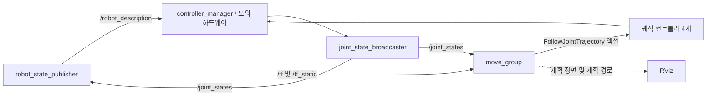

# Piper Arm MoveIt 설정

좌우 그리퍼가 달린 듀얼 Piper Arm의 MoveIt 2 동작 계획 설정입니다.

## 빌드 및 실행

```bash
colcon build --packages-select realsense2_description piper_arm_description piper_arm_moveit_config
source install/setup.zsh
ros2 launch piper_arm_moveit_config demo.launch.py
```

Gazebo Sim에서 MoveIt 경로 실행을 시험하려면 `ros-jazzy-gz-ros2-control`,
`ros-jazzy-ros-gz-sim`, `ros-jazzy-ros-gz-bridge`를 설치한 뒤 실행합니다.

```bash
ros2 launch piper_arm_moveit_config gazebo_moveit.launch.py
```

이 launch는 Gazebo Sim의 빈 월드에 같은 듀얼 Piper 모델을 생성하고,
`gz_ros2_control`의 컨트롤러를 통해 MoveIt 실행 명령을 시뮬레이터 관절에 전달합니다.
`/clock`과 모든 ROS 노드는 시뮬레이션 시간을 사용합니다. RViz에서 경로를 계획한 뒤
`Execute`를 누르면 Gazebo의 로봇도 움직여야 합니다.

데모는 `robot_state_publisher`, 모의 `ros2_control` 하드웨어, 관절 상태 브로드캐스터,
궤적 컨트롤러, `move_group`, RViz를 실행합니다. RViz에서 계획한 경로는
`mock_components/GenericSystem`에서 실행되며, 시뮬레이터나 실제 로봇에는
명령을 보내지 않습니다.

왼쪽 그리퍼에 카메라 스탠드와 RealSense D435 모델이 표시됩니다. 이 데모는
카메라 영상 토픽을 생성하지 않습니다.

## 노드와 통신 그래프

`demo.launch.py`는 다음 프로세스를 시작합니다.

| 프로세스 | ROS 노드 또는 역할 |
| --- | --- |
| `robot_state_publisher` | 로봇 모델을 발행하고 관절 상태를 바탕으로 TF를 발행합니다. |
| `ros2_control_node` | 모의 하드웨어 `PiperDualArmMockSystem`과 함께 `/controller_manager`를 실행합니다. |
| `spawner` 프로세스 2개 | 관절 상태 브로드캐스터와 궤적 컨트롤러 4개를 로드·활성화한 뒤 종료합니다. |
| `move_group` | 동작을 계획하고 궤적을 컨트롤러에 전달합니다. 내부 ROS 노드를 추가로 생성할 수 있습니다. |
| `rviz2` | GUI가 실행 중일 때 로봇, 계획 장면, 계획 경로를 표시합니다. |



| 인터페이스 | 발행자 / 서버 | 구독자 / 클라이언트 |
| --- | --- | --- |
| `/robot_description` | `robot_state_publisher` | `controller_manager` (`/controller_manager/robot_description`에서 리매핑) |
| `/joint_states` | `joint_state_broadcaster` | `robot_state_publisher`, MoveIt 계획 장면 모니터 |
| `/dynamic_joint_states` | `joint_state_broadcaster` | 관절 상태 확인용 |
| `/tf`, `/tf_static` | `robot_state_publisher` | MoveIt 및 실행 중인 RViz 등의 TF 리스너 |
| `/monitored_planning_scene` | MoveIt 계획 장면 모니터 | 계획 장면을 사용하는 노드 |
| `/display_planned_path` | MoveIt 시각화 구성요소 | 실행 중인 RViz의 MotionPlanning 디스플레이 |
| `/<controller>/joint_trajectory` | 선택적으로 궤적 명령을 발행하는 노드 | 해당 궤적 컨트롤러 |
| `/<controller>/controller_state` | 해당 궤적 컨트롤러 | 상태를 모니터링하는 노드 |

MoveIt은 보통 `/<controller>/joint_trajectory` 토픽에 직접 발행하는 대신,
`config/moveit_controllers.yaml`에 설정된 `FollowJointTrajectory` **액션**으로
궤적을 실행합니다. 액션 서버 4개는 다음과 같습니다.

- `/left_arm_controller/follow_joint_trajectory`
- `/right_arm_controller/follow_joint_trajectory`
- `/left_gripper_controller/follow_joint_trajectory`
- `/right_gripper_controller/follow_joint_trajectory`

컨트롤러와 담당 관절은 `config/ros2_controllers.yaml`에 정의되어 있습니다.
실행 중인 그래프는 `ros2 node list`, `ros2 topic list -t`,
`ros2 action list -t`, `ros2 control list_controllers`로 확인할 수 있습니다.
RViz가 종료되면 RViz가 생성한 노드와 통신 연결은 그래프에서 사라집니다.

MoveIt의 계획 장면과 인식 결과 연결 방식은 [Planning Scene Monitor 해설](PLANNING_SCENE_MONITOR.ko.md)을 참고하세요.
