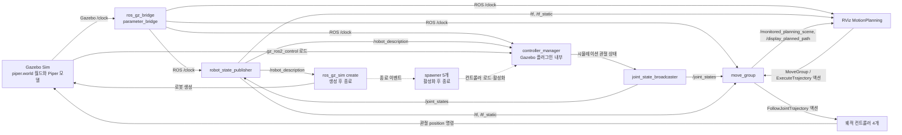

# `gazebo_moveit.launch.py` 실행 그래프

[`launch/gazebo_moveit.launch.py`](launch/gazebo_moveit.launch.py)를 ROS 2 Jazzy와 Gazebo Sim에서 실행해 확인한 노드·토픽·액션 흐름입니다. 2026-10-13에 `gz_ros2_control` 설치 후 독립된 `ROS_DOMAIN_ID=83`에서 검사했습니다.

## 월드 SDF와 로봇 URDF

`gz_args`는 [`world/piper.world`](world/piper.world)를 엽니다. 이 월드는 카메라 렌더링에 필요한 Gazebo Sensors 시스템을 로드합니다. 로봇은 [`config/piper_dual_gripper.urdf.xacro`](config/piper_dual_gripper.urdf.xacro)를 `use_gazebo=true`로 확장한 URDF를 `/robot_description`에서 읽어 생성합니다. 이 Xacro에는 양쪽 D435의 RGB-D 센서가 정의되어 있습니다. Gazebo의 SDFormat 라이브러리가 URDF를 내부적으로 SDF 모델로 변환하므로 별도의 로봇 SDF 파일은 필요하지 않습니다. [Gazebo의 URDF 생성 안내](https://gazebosim.org/docs/latest/spawn_urdf/)도 이 방식을 설명합니다.

실행 로그에서 로봇 생성 성공, `gz_ros2_control` 플러그인 로드, 16개 관절의 하드웨어 인터페이스 등록을 확인했습니다. 하드웨어 컴포넌트 이름은 현재 Xacro에 적힌 `PiperDualArmMockSystem`이지만, `use_gazebo=true`에서 로드되는 **구현체**는 `gz_ros2_control/GazeboSimSystem`입니다.

## 실제 실행 흐름도



점선은 프로세스 종료 이벤트와 서비스 기반 활성화 요청입니다. `controller_manager` 및 컨트롤러 노드는 Gazebo 프로세스의 `gz_ros2_control` 플러그인에서 생성되며, 별도의 `ros2_control_node` 프로세스는 없습니다. `create`와 spawner 5개는 작업 후 종료됩니다. `move_group`과 RViz는 컨트롤러 활성화와 병행해 시작합니다.

RViz → `move_group` → 컨트롤러 액션은 설정과 실행 그래프에서 확인한 경로입니다. 아래 동작 시험은 컨트롤러 액션을 **직접** 호출했습니다. RViz에서 계획·실행 버튼을 눌러 전체 MoveIt 경로를 통과하는 시험은 수행하지 않았습니다.

## 확인된 ROS 인터페이스

| 인터페이스 | 발행자 / 서버 | 구독자 / 클라이언트 | 확인 결과 |
| --- | --- | --- | --- |
| `/clock` | `ros_gz_bridge` | 시뮬레이션 시간 사용 노드 | Gazebo 시간을 ROS로 전달 |
| `/robot_description` | `robot_state_publisher` | `create`, `controller_manager` | URDF 전달; 컨트롤러 매니저의 구독을 실행 중 확인 |
| `/joint_states` | `joint_state_broadcaster` | `robot_state_publisher`, MoveIt 상태 모니터 | 16개 관절의 실제 메시지 수신 |
| `/dynamic_joint_states` | `joint_state_broadcaster` | 상태 확인용 구독자 | 토픽 확인 |
| `/tf`, `/tf_static` | `robot_state_publisher` | MoveIt, RViz의 TF 리스너 | 토픽 확인 |
| `/monitored_planning_scene` | MoveIt 계획 장면 모니터 등 | RViz 등 | 토픽 확인 |
| `/display_planned_path` | `move_group` | RViz | 발행·구독 연결 확인 |
| `/<controller>/controller_state` | 각 궤적 컨트롤러 | 상태 확인용 구독자 | 컨트롤러 4개 토픽 확인 |
| `/<controller>/joint_trajectory` | 외부 궤적 발행자 | 각 궤적 컨트롤러 | 토픽은 존재하지만 이번 실행 명령에는 사용하지 않음 |

활성화된 컨트롤러는 `joint_state_broadcaster`, `left_arm_controller`, `right_arm_controller`, `left_gripper_controller`, `right_gripper_controller`입니다. MoveIt의 실행 경로로 설정된 액션 서버 4개도 확인했습니다.

- `/left_arm_controller/follow_joint_trajectory`
- `/right_arm_controller/follow_joint_trajectory`
- `/left_gripper_controller/follow_joint_trajectory`
- `/right_gripper_controller/follow_joint_trajectory`

컨트롤러의 관절과 인터페이스는 [`config/ros2_controllers.yaml`](config/ros2_controllers.yaml), MoveIt의 액션 매핑은 [`config/moveit_controllers.yaml`](config/moveit_controllers.yaml)에 정의되어 있습니다.

양쪽 그리퍼에는 D435 모델과 Gazebo RGB-D 센서가 정의되어 있습니다. 현재 launch는 `/clock`과 양쪽 카메라의 RGB, 깊이 영상, 카메라 정보, 포인트클라우드를 브리지합니다. 왼쪽 카메라 영상에서 월드의 빨간 시험 상자를 확인했습니다. [YOLOv8 물체 인식 노드](../../docs/piper_tcp_pregrasp.md#gazebo-영상에서-물체-pose-받기)는 별도로 실행하며, 빨간 시험 상자를 검출하려면 그 물체로 학습한 ONNX 모델이 필요합니다.

## 동작 시험 결과

`ros2 control list_controllers`에서 5개 컨트롤러가 모두 `active`였고, 하드웨어 컴포넌트도 `active`였습니다. `/left_arm_controller/follow_joint_trajectory`에 `left_arm_joint1=0.1 rad` 목표를 3초 궤적으로 전송한 결과 `SUCCEEDED` 및 `error_code: 0`을 받았습니다. 이어서 `/joint_states`에서 `left_arm_joint1 ≈ 0.1 rad`를 확인하고, 동일 액션으로 0 rad 복귀를 완료했습니다. 이 결과는 **컨트롤러 → Gazebo 관절 → `/joint_states`** 경로가 동작함을 보여줍니다.

시험 종료 시 Gazebo 실행을 중단한 뒤 `move_group`이 종료 과정에서 코드 `-11`로 종료된 기록이 있습니다. 실행 중 위의 컨트롤러 동작 시험은 성공했으며, 종료 오류의 원인은 이번 검사 범위에서 분석하지 않았습니다.

`ROS_DOMAIN_ID=83`은 이번 시험을 다른 ROS 실행과 분리하기 위해 임의로 고른 값입니다. launch가 요구하는 설정은 아닙니다. 평소에는 `ROS_DOMAIN_ID`를 지정하지 않고 다음처럼 실행하면 됩니다.

```bash
source install/setup.zsh
ros2 launch piper_arm_moveit_config gazebo_moveit.launch.py
```

다른 터미널에서:

```bash
source install/setup.zsh
ros2 node list --no-daemon
ros2 topic list --no-daemon -t
ros2 action list -t
ros2 control list_controllers -c /controller_manager
```

검사 시 기본 ROS CLI 데몬이 다른 도메인의 오래된 목록을 보여주어 `--no-daemon`으로 직접 검색했습니다. 여러 ROS 시스템을 동시에 실행해 분리해야 한다면 사용하지 않는 도메인 ID를 선택하고, **launch 터미널과 검사 터미널에 같은 값**을 설정하세요. 예를 들어 두 터미널 모두에서 `export ROS_DOMAIN_ID=83`을 실행한 뒤 위 명령을 사용할 수 있습니다.
